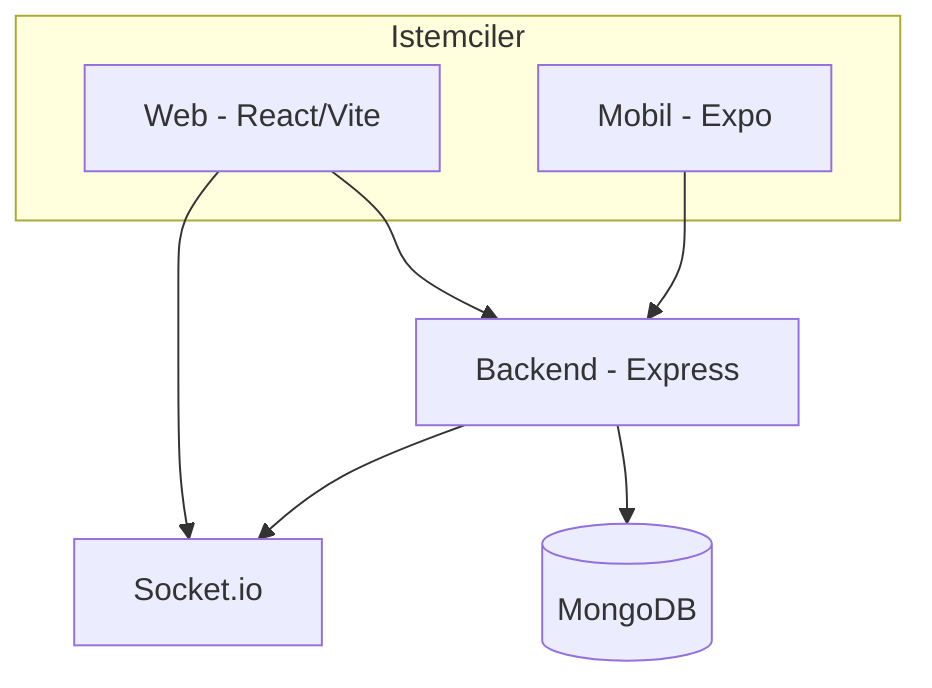
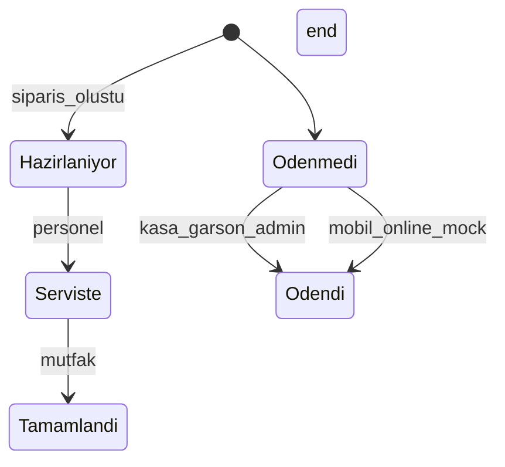

# Mimari

## Genel bakış

Self Kasa, restoranlarda QR ile masa bağlama ve self-servis sipariş akışını destekleyen üç katmanlı bir sistemdir.

## Uygulamalar

| Katman | Klasör | Kullanıcılar |
|--------|--------|--------------|
| Backend | `backend/` | Tüm istemciler (REST + WebSocket) |
| Web | `frontend/` | Müşteri kiosk, admin, garson, mutfak, kasa, süper admin |
| Mobil | `mobile/` | Müşteri (`musteri` rolü) |

## Roller

| Rol | Açıklama | Web yolu |
|-----|----------|----------|
| `superadmin` | Şube ve kullanıcı yönetimi | `/superadmin` |
| `admin` | Şube operasyonları, menü, sipariş | `/admin` |
| `yetkili` | Genişletilmiş personel yetkisi | Garson/mutfak/kasa ile paylaşımlı |
| `garson` | Masa ve sipariş | `/waiter` |
| `mutfak` | Mutfak ekranı (istasyonlar) | `/kitchen` |
| `kasa` | Ödeme alma | `/cashier` |
| `musteri` | Self-servis sipariş | Mobil + web müşteri |

## Veri modelleri (özet)

- **Branch** — şube
- **Table** — masa (QR ile ilişkili)
- **Product / Category** — menü
- **Order / OrderEvent** — sipariş ve audit
- **User** — kimlik, rol, şube, sadakat puanı
- **Campaign**, **QRCode**, **Payment**, **StockMovement**

## API grupları

| Prefix | Amaç |
|--------|------|
| `/api/auth` | Giriş, kayıt (müşteri), profil |
| `/api/products`, `/api/categories` | Herkese açık menü (GET) |
| `/api/orders` | Müşteri sipariş oluşturma ve takip |
| `/api/admin/*` | Şube yönetimi (korumalı) |
| `/api/waiter/*`, `/api/kitchen/*`, `/api/cashier/*` | Personel |
| `/api/superadmin/*` | Çok şubeli yönetim |
| `/api/qr`, `/api/campaigns`, `/api/calorie` | QR, kampanya, kalori |

## Gerçek zamanlı olaylar (Socket.io)

Odalar:

- `kitchen.{branchId}.{station}` — mutfak istasyonu
- `waiter.{waiterId}` — garson bildirimleri
- `admin.metrics.{branchId}` — dashboard metrikleri
- `tables` — masa durumu (admin/garson)
- `customer.{userId}` — müşteri sipariş durumu

Örnek olaylar: `table:order:created`, `table:order:status:changed`, `order:status:updated` (müşteri).

## Sipariş, ödeme ve iptal

| Mobil `paymentMethod` | Backend | Kasa listesi | Personel tahsilat |
|----------------------|---------|--------------|-------------------|
| `table` | `paymentStatus: unpaid` | Bekler | Garson / kasa |
| `cashier` | `paymentStatus: unpaid` | Öncelikli bekler | Kasa |
| `online` + `paymentConfirmed` | `paid` + `paidAt` (demo) | Listede yok | Gerekmez |

**İptal:** `POST /api/orders/:id/cancel` veya `PUT /api/admin/orders/:id/cancel` / `POST /api/waiter/orders/:id/cancel` — yalnızca hazırlık başlamadan (`hazirlaniyor`, `CREATED`, `SENT_TO_KITCHEN`; kalem `STARTED`/`IN_PREP` yok). Stok iadesi QR siparişlerinde uygulanır.

**Ödeme standardı:** Tahsilat sonrası `status: ödendi`, `paymentStatus: paid`, `paidAt` dolu. Garson: `POST /api/waiter/payments`.

| Rol | Sipariş oluştur | Tahsilat | İptal (erken) |
|-----|-----------------|----------|---------------|
| Müşteri (mobil) | `POST /api/orders` | Online mock | — |
| Garson | `POST /api/waiter/orders` | `POST /api/waiter/payments` | Evet |
| Mutfak | — | — | — |
| Kasa | — | `POST /api/cashier/checkout/:tableId` (`method`: cash/card), `GET /api/cashier/summary` | Evet |

**Kasa API (bitirme paketi):**

| Endpoint | Açıklama |
|----------|----------|
| `GET /api/cashier/tables` | **Tüm** masalar; `hasPendingPayment` ile ödeme bekleyenler işaretli |
| `GET /api/cashier/pending` | Yalnızca ödeme bekleyen masalar (eski uyumluluk) |
| `GET /api/cashier/summary` | Bugünkü nakit/kart tahsilat, bekleyen masa/tutar |
| `POST /api/cashier/checkout/:tableId` | Masa toplu tahsilat → `Payment` + `OrderEvent` + `DailyAggregate` |

Tahsilat mantığı `utils/recordOrderPayment.js` (garson `POST /api/waiter/payments` ve admin `PUT .../pay` ile ortak).

**Kapsam dışı (bilinçli):** fiş yazıcı, e-fatura, vardiya kasası, bölünmüş hesap, iade UI, gerçek ödeme gateway.

**Kasa kullanıcısı:** `node backend/scripts/createKasaUser.js [email] [şifre]`
| Admin | API | `PUT /api/admin/orders/:id/pay` | Evet |

**Not:** Mobil kupon kodları (`HOSGELDIN10` vb.) yalnızca sepet önizlemesinde ve sipariş notunda; backend toplamdan otomatik düşmez.

## Güvenlik

- JWT (`Authorization: Bearer`)
- `helmet` + rate limit (production)
- CORS: production origin listesi + yerel ağ
- Müşteri kaydı: `ALLOW_PUBLIC_REGISTER` (production’da isteğe bağlı kapatılabilir)
- Personel CRUD: yalnızca `/api/admin/*` ve rol middleware

## Ortam değişkenleri

Bkz. [README.md](../README.md) ve [DEPLOY.md](./DEPLOY.md).
