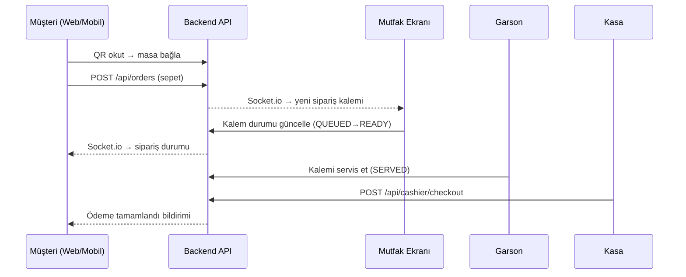
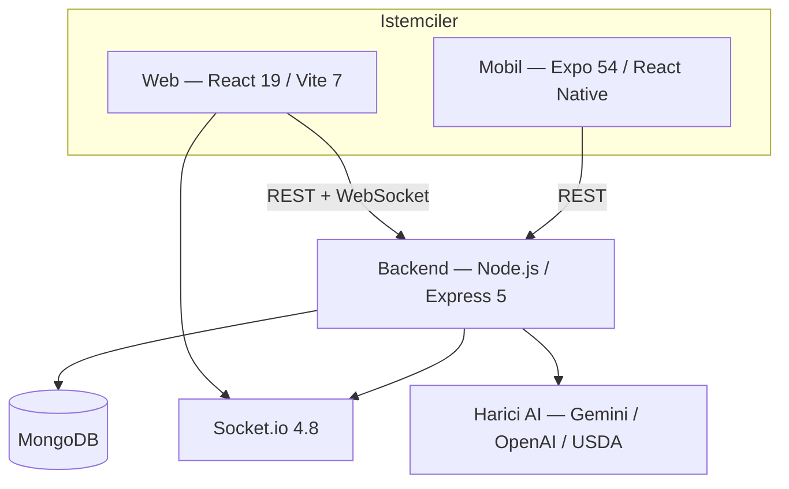
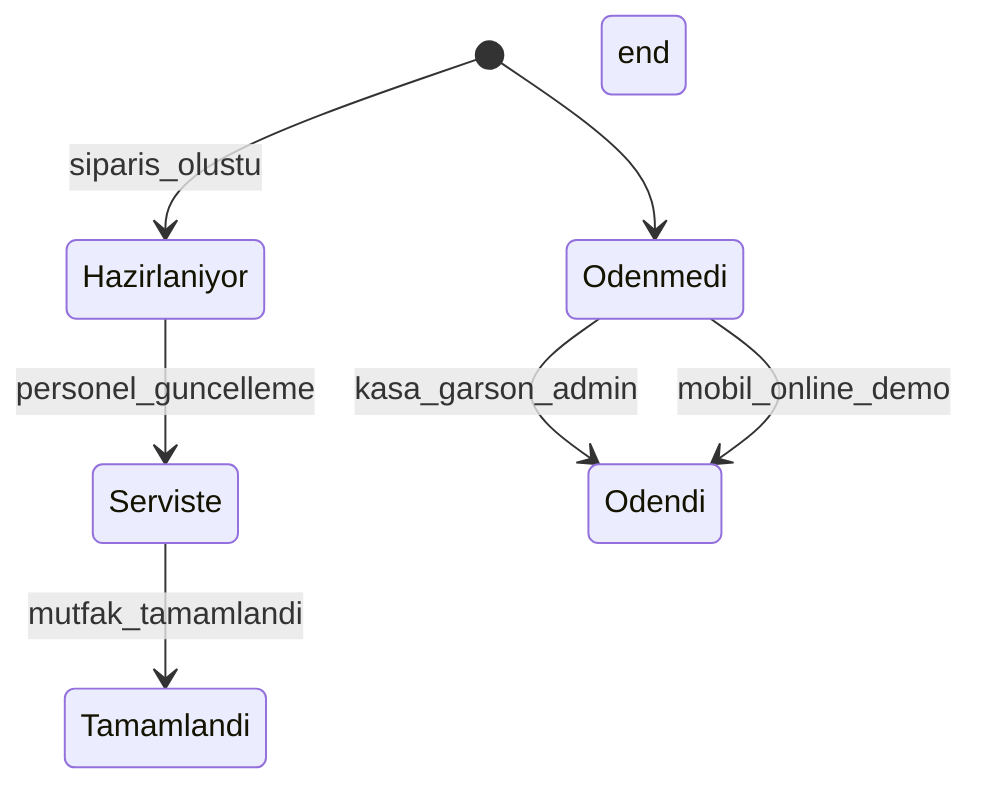

# Self Kasa — Jüri Sunumu Teknik Rehberi (A'dan Z'ye)

> **Proje adı:** bitirme-pos-sistemi  
> **Ticari ad:** Self Kasa  
> **Tür:** QR tabanlı self-servis restoran POS ve operasyon yönetim sistemi  
> **Katmanlar:** Backend API + Web (React) + Mobil (Expo)  
> **Son güncelleme:** Haziran 2025

Bu belge, bitirme projesi jüri sunumunda sorulabilecek **tüm teknik konuları** tek yerde toplar: mimari, teknolojiler, güvenlik, API, veritabanı, gerçek zamanlı iletişim, yapay zeka özellikleri, test, dağıtım ve demo senaryosu.

---

## İçindekiler

1. [30 Saniyelik Özet](#1-30-saniyelik-özet)
2. [Problem ve Çözüm](#2-problem-ve-çözüm)
3. [Sistem Mimarisi](#3-sistem-mimarisi)
4. [Teknoloji Yığını](#4-teknoloji-yığını)
5. [Kullanıcı Rolleri ve Yetkilendirme](#5-kullanıcı-rolleri-ve-yetkilendirme)
6. [Modüller ve Özellikler](#6-modüller-ve-özellikler)
7. [Veritabanı Modelleri](#7-veritabanı-modelleri)
8. [Sipariş ve Ödeme Yaşam Döngüsü](#8-sipariş-ve-ödeme-yaşam-döngüsü)
9. [API Referansı](#9-api-referansı)
10. [Gerçek Zamanlı İletişim (Socket.io)](#10-gerçek-zamanlı-iletişim-socketio)
11. [Yapay Zeka ve Beslenme Özellikleri](#11-yapay-zeka-ve-beslenme-özellikleri)
12. [Güvenlik Önlemleri (Detaylı)](#12-güvenlik-önlemleri-detaylı)
13. [Test ve Kalite Güvencesi](#13-test-ve-kalite-güvencesi)
14. [CI/CD ve DevOps](#14-cicd-ve-devops)
15. [Dağıtım ve Ortam Değişkenleri](#15-dağıtım-ve-ortam-değişkenleri)
16. [Demo Senaryosu (Savunma)](#16-demo-senaryosu-savunma)
17. [Jüri İçin Sık Sorulan Sorular](#17-jüri-için-sık-sorulan-sorular)
18. [Bilinçli Kapsam Dışı Bırakılanlar](#18-bilinçli-kapsam-dışı-bırakılanlar)
19. [Tez Bölüm Eşlemesi](#19-tez-bölüm-eşlemesi)
20. [Önerilen Sunum Akışı](#20-önerilen-sunum-akışı)

---

## 1. 30 Saniyelik Özet

**Self Kasa**, restoranlarda müşterinin QR kod ile masaya bağlanıp menüden sipariş vermesini; garson, mutfak, kasa ve yöneticinin aynı siparişi gerçek zamanlı takip etmesini sağlayan **üç katmanlı bir POS sistemidir**.

| Özellik | Açıklama |
|---------|----------|
| Self-servis | QR → masa bağlama → menü → sepet → sipariş |
| Çok rollü | 7 farklı kullanıcı rolü (superadmin → müşteri) |
| Çok şubeli | Süper admin ile birden fazla şube yönetimi |
| Gerçek zamanlı | Socket.io ile anlık sipariş/masa güncellemeleri |
| AI destekli | Ürün besin değeri tahmini + müşteri kalori asistanı |
| Güvenlik | JWT, bcrypt, rate limit, CORS, şube izolasyonu |

---

## 2. Problem ve Çözüm

### 2.1 Problem

Restoranlarda geleneksel sipariş akışı dağınıktır:

- Müşteri garsonu bekler, sipariş sözlü iletilir
- Mutfak bilgisi gecikmeli veya eksik ulaşır
- Kasa tahsilatı ile mutfak durumu senkronize değildir
- Çok şubeli işletmelerde merkezi yönetim zordur

### 2.2 Çözüm

Tek platformda birleşen dijital akış:



### 2.3 Temel Hedefler

| # | Hedef | Nasıl karşılanıyor |
|---|-------|---------------------|
| 1 | Self-servis sipariş | QR kod + web kiosk + mobil uygulama |
| 2 | Operasyonel verimlilik | Garson, mutfak, kasa ayrı ekranlar |
| 3 | Anlık bilgi | Socket.io WebSocket bildirimleri |
| 4 | Çok şube | Branch modeli + superadmin paneli |
| 5 | Müşteri sadakati | Loyalty points sistemi |
| 6 | Beslenme bilinci | AI kalori asistanı ve ürün besin değerleri |
| 7 | Güvenli erişim | JWT + rol bazlı yetkilendirme |

---

## 3. Sistem Mimarisi

### 3.1 Genel Bakış



### 3.2 Monorepo Yapısı

```
bitirme-pos-sistemi/
├── backend/          # Node.js API + Socket.io + Mongoose
├── frontend/         # React web (müşteri kiosk + tüm personel panelleri)
├── mobile/           # Expo müşteri uygulaması
├── docs/             # Mimari, güvenlik, dağıtım, bu belge
├── .github/workflows/ci.yml
├── docker-compose.yml
├── backups/          # Yerel JSON yedekleri (.gitignore)
└── README.md
```

**Not:** Kök dizinde tek `package.json` yok; her katman bağımsız npm projesidir. Katmanlar arası iletişim yalnızca REST API ve WebSocket üzerinden yapılır (paylaşımlı kod paketi yoktur).

### 3.3 İstemci–Sunucu İlişkisi

| Katman | Klasör | Hedef kullanıcı |
|--------|--------|-----------------|
| Backend | `backend/` | Tüm istemciler (REST + WebSocket) |
| Web | `frontend/` | Müşteri kiosk, admin, garson, mutfak, kasa, süper admin |
| Mobil | `mobile/` | Müşteri (`musteri` rolü) |

### 3.4 Backend Katman Mimarisi

```
backend/
├── server.js              # Giriş noktası (DB bağlantısı, port dinleme)
├── app.js                 # Express fabrikası + Socket.io + middleware zinciri
├── models/                # 14 Mongoose şeması
├── routes/                # REST endpoint grupları
├── middleware/            # Auth, rol, rate limit, upload, socket auth
├── services/              # AI beslenme servisleri
├── utils/                 # Ödeme, iptal, fiyat, socket yardımcıları
├── scripts/               # Bootstrap ve migrasyon scriptleri (32 adet)
├── tests/                 # Vitest testleri
└── uploads/avatars/       # Profil görselleri
```

### 3.5 Frontend Modüler Yapı

```
frontend/src/
├── app/                   # App.jsx, main.jsx
├── features/
│   ├── admin/             # Yönetim paneli
│   ├── auth/              # Giriş sayfası
│   ├── cashier/           # Kasa ekranı
│   ├── customer/          # Müşteri kiosk (menü, sepet, QR)
│   ├── kitchen/           # Mutfak ekranı
│   ├── superadmin/        # Merkezi yönetim
│   └── waiter/            # Garson paneli
└── shared/                # Context, guard, API client, UI bileşenleri
```

---

## 4. Teknoloji Yığını

### 4.1 Backend

| Teknoloji | Sürüm | Kullanım amacı |
|-----------|-------|----------------|
| Node.js | ≥ 18 (Docker: 20-alpine) | Sunucu runtime |
| Express | 5.1 | REST API çatısı |
| MongoDB + Mongoose | 8.x | NoSQL veritabanı ve ODM |
| Socket.io | 4.8 | Gerçek zamanlı WebSocket |
| jsonwebtoken | 9.x | JWT oturum yönetimi |
| bcryptjs | 3.x | Şifre hashleme (salt: 10) |
| express-rate-limit | 8.x | İstek sınırlama |
| helmet | 8.x | HTTP güvenlik başlıkları (production) |
| cors | 2.8.x | Cross-Origin Resource Sharing |
| multer | 2.x | Avatar dosya yükleme |
| qrcode | 1.5 | QR kod üretimi |
| dotenv | 17.x | Ortam değişkeni yönetimi |
| vitest + supertest | — | Birim/entegrasyon testleri |
| mongodb-memory-server | — | İzole test veritabanı |

### 4.2 Web (Frontend)

| Teknoloji | Kullanım amacı |
|-----------|----------------|
| React 19 | UI bileşenleri |
| Vite 7 | Derleme ve dev sunucusu |
| MUI 7 + Emotion | Material Design bileşenleri |
| React Router 7 | Sayfa yönlendirme ve rol koruması |
| TanStack Query 5 | Sunucu durumu ve önbellekleme |
| Axios | HTTP istemcisi |
| Socket.io Client 4.8 | Gerçek zamanlı güncellemeler |
| html5-qrcode | Web QR tarayıcı |
| Tailwind CSS 4 | Ek stil katmanı |
| ExcelJS / jsPDF | Rapor dışa aktarma (Excel/PDF) |
| jwt-decode | Token decode (istemci tarafı) |
| date-fns, lucide-react | Tarih ve ikon yardımcıları |

### 4.3 Mobil

| Teknoloji | Kullanım amacı |
|-----------|----------------|
| Expo 54 | Cross-platform mobil geliştirme |
| React Native 0.81 | Native UI |
| React Navigation 7 | Ekran geçişleri (native stack) |
| expo-camera | QR kod tarama |
| expo-secure-store | Güvenli token saklama (şifreli depolama) |
| AsyncStorage | Oturum ve tercih verileri |
| expo-image-picker / manipulator | Profil fotoğrafı |
| axios | API istemcisi |
| lottie-react-native | Animasyonlar |
| Jest + jest-expo | Birim testleri |
| EAS Build | Android APK üretimi |

### 4.4 DevOps

| Araç | Kullanım |
|------|----------|
| Docker Compose | MongoDB + backend + frontend konteynerleri |
| GitHub Actions | CI pipeline (test, lint, build, audit) |
| Nginx | Production reverse proxy + Socket.io WebSocket upgrade |
| EAS (Expo) | Mobil APK build |

---

## 5. Kullanıcı Rolleri ve Yetkilendirme

### 5.1 Rol Tablosu

| Rol | Kod | Erişim kapsamı | Web yolu |
|-----|-----|----------------|----------|
| Süper Admin | `superadmin` | Tüm şubeler, kullanıcı/şube CRUD | `/superadmin` |
| Admin | `admin` | Tek şube: menü, masa, sipariş, QR, kampanya | `/admin` |
| Yetkili | `yetkili` | Genişletilmiş personel yetkisi | Garson/mutfak/kasa ile paylaşımlı |
| Garson | `garson` | Masa yönetimi, sipariş, tahsilat | `/waiter` |
| Mutfak | `mutfak` | Mutfak kuyruğu, istasyon bazlı | `/kitchen` |
| Kasa | `kasa` | Ödeme alma, gün özeti | `/cashier` |
| Müşteri | `musteri` | Self-servis sipariş | Mobil + web müşteri |

### 5.2 Yetkilendirme Zinciri

```
İstek → authMiddleware (JWT doğrulama)
      → requireRole(...) (rol kontrolü, 403)
      → branchAccess / requireStaffBranch (şube izolasyonu)
      → Route handler (iş mantığı)
```

### 5.3 JWT (JSON Web Token) Detayları

| Özellik | Değer |
|---------|-------|
| Secret | `JWT_SECRET` ortam değişkeni (min. 32 karakter) |
| Süre | 7 gün (`expiresIn: '7d'`) |
| Header | `Authorization: Bearer <token>` (legacy: `x-auth-token`) |
| Payload | `{ id: userId }` veya `{ id, role, email, name }` |
| Doğrulama | Her korumalı istekte DB'den aktif kullanıcı sorgulanır |

### 5.4 Middleware Katmanları

| Dosya | Görev |
|-------|-------|
| `authMiddleware.js` | JWT doğrulama, `req.user` doldurma |
| `optionalAuthMiddleware` | Token yoksa devam (misafir sipariş desteği) |
| `requireRole.js` | Rol bazlı 403 kontrolü |
| `requireSuperAdmin.js` | Yalnızca superadmin |
| `requireStaffBranch.js` | Personel için `branchId` zorunluluğu |
| `branchAccess.js` | `req.branchFilter` ile şube izolasyonu |
| `socketAuth.js` | Socket.io bağlantısında JWT + oda aboneliği kontrolü |
| `rateLimiters.js` | Giriş ve kalori endpoint özel limitleri |
| `uploadAvatar.js` | Multer ile güvenli avatar yükleme |

### 5.5 İstemci Tarafı Koruma

**Web:**
- `RoleGuard` + `ProtectedRoute` — rol kontrolü
- `passwordMeetsPolicy` — zayıf şifrede şifre değiştirme zorunluluğu
- `AuthContext` — JWT oturum yönetimi

**Mobil:**
- `AuthContext` + `expo-secure-store` — token güvenli depolama
- Zayıf şifrede `ChangePasswordScreen` zorunlu yönlendirme

### 5.6 Şifre Politikası

- Minimum 8 karakter
- En az bir büyük harf, bir küçük harf, bir rakam, bir sembol
- Kayıt ve şifre değişiminde zorunlu
- Eski kullanıcılar girişte upgrade edilir (`passwordMeetsPolicy` alanı)
- Hash: bcrypt, salt rounds: 10 (`User` model pre-save hook)

---

## 6. Modüller ve Özellikler

### 6.1 Müşteri (Web Kiosk + Mobil)

| Özellik | Açıklama |
|---------|----------|
| QR / masa bağlama | `/qr-scan` (web) veya `QRScannerScreen` (mobil) |
| Menü görüntüleme | Kategori ve ürün listesi (public API) |
| Sepet ve sipariş | `CartContext`, `POST /api/orders` |
| Sipariş geçmişi | `GET /api/orders/mine` |
| Şube bazlı filtreleme | `GET /api/orders/mine/branches` |
| Sadakat puanı | `loyaltyPoints` — ödeme sonrası kazanım |
| Kampanyalar | Aktif kampanya listesi |
| Favoriler | Mobil `FavoritesContext` |
| Profil ve avatar | `PATCH /api/auth/me`, avatar upload |
| Kalori asistanı | AI sohbet (`CalorieEstimateScreen`) |
| Gerçek zamanlı takip | Socket.io `customer.{userId}` odası |

### 6.2 Admin Paneli (`/admin`)

| Modül | Özellikler |
|-------|------------|
| Dashboard | KPI kartları, günlük istatistik, gerçek zamanlı metrikler |
| Sipariş yönetimi | Liste, durum güncelleme, iptal, ödeme |
| Masa yönetimi | CRUD, durum takibi (bos/dolu/rezerve/odeme_bekliyor) |
| Ürün yönetimi | CRUD, fiyat, stok, mutfak istasyonu, besin değerleri |
| Kategori yönetimi | Şube bazlı kategori CRUD |
| Kampanya yönetimi | Sepet indirimi, menü kampanyaları |
| QR yönetimi | Masa QR kodları üretme ve yönetme |
| Besin değeri | AI ile ürün besin tahmini + onay akışı |
| Raporlar | Günlük rapor, Excel/PDF export |

### 6.3 Garson Paneli (`/waiter`)

- Tüm masaların listesi ve durumu
- Masa detayında aktif siparişler
- Yeni sipariş oluşturma ve mutfağa gönderme
- Hazır kalemleri servis etme (`SERVED`)
- Ödeme tahsilatı (`POST /api/waiter/payments`)
- Gerçek zamanlı masa güncellemeleri

### 6.4 Mutfak Ekranı (`/kitchen`)

- İstasyon bazlı kuyruk: `hot`, `cold`, `bar`, `dessert`
- Kalem durumu akışı: `QUEUED` → `STARTED` → `READY` → `SERVED`
- Sipariş geçmişi
- Socket.io ile anlık yeni sipariş bildirimi
- Her istasyon ayrı socket odasında (`kitchen.{branchId}.{station}`)

### 6.5 Kasa Ekranı (`/cashier`)

- Tüm masalar + `hasPendingPayment` işareti
- Masa toplu tahsilat (nakit/kart)
- Gün özeti: bugünkü nakit/kart tahsilat, bekleyen tutar
- `GET /api/cashier/summary` ile özet rapor

### 6.6 Süper Admin (`/superadmin`)

- Şube CRUD (çok şubeli yapı)
- Kullanıcı CRUD (tüm şubeler)
- Şifre sıfırlama
- Rol atama

---

## 7. Veritabanı Modelleri

**Veritabanı:** MongoDB  
**Bağlantı:** `MONGO_URI` (varsayılan: `mongodb://localhost:27017/bitirme`)  
**ODM:** Mongoose 8.x  
**Toplam model sayısı:** 14

### 7.1 Model Özet Tablosu

| Model | Dosya | Temel alanlar | Görev |
|-------|-------|---------------|-------|
| **User** | `User.js` | email, passwordHash, role, branchId, loyaltyPoints, avatarUrl | Kimlik ve yetki |
| **Branch** | `Branch.js` | name, address, phone, isActive | Şube tanımı |
| **Table** | `Table.js` | name, capacity, status, branchId | Masa yönetimi |
| **Category** | `Category.js` | name, branchId | Menü kategorileri |
| **Product** | `Product.js` | price, salePrice, station, countInStock, nutrition{}, branchId | Ürün ve besin değerleri |
| **Order** | `Order.js` | orderItems[], status, paymentStatus, customer, branchId | Sipariş yaşam döngüsü |
| **OrderEvent** | `OrderEvent.js` | type, from, to | Audit log (TTL: 90 gün) |
| **Payment** | `Payment.js` | method, amount, status | Tahsilat kaydı |
| **Campaign** | `Campaign.js` | discountRate, campaignType, bundlePrice | Kampanyalar |
| **QRCode** | `QRCode.js` | tableNumber, qrUrl, qrCode, tableId | QR kodlar |
| **StockMovement** | `StockMovement.js` | delta, reason | Stok hareketleri |
| **DailyAggregate** | `DailyAggregate.js` | date, revenue, orders, canceled | Günlük ciro özeti |
| **MealCalorieEstimate** | `MealCalorieEstimate.js` | userInputText, estimatedCalories, confidence | AI kalori geçmişi |
| **MenuItem** | `MenuItem.js` | — | Eski menü modeli (geriye dönük uyumluluk) |

### 7.2 Order Modeli — Durum Makinesi

**Sipariş durumu (`status`):**
```
hazirlaniyor → serviste → tamamlandi / ödendi / iptal
```

**Kalem durumu (`orderItems[].status`):**
```
QUEUED → STARTED → READY → SERVED
```

**Mutfak istasyonu (`orderItems[].station`):**
```
hot | cold | bar | dessert
```

**Ödeme durumu (`paymentStatus`):**
```
unpaid → paid / refunded
```

### 7.3 Şema Özellikleri

- **Çok şubeli filtreleme:** `branchId` indeksleri tüm ilgili modellerde
- **Geriye dönük uyumluluk:** Order hem eski (`items`) hem yeni (`orderItems`) formatı destekler
- **Otomatik hash:** User şifreleri `pre-save` hook ile bcrypt hashlenir
- **TTL indeks:** OrderEvent kayıtları 90 gün sonra otomatik silinir
- **Compound unique:** Category isimleri şube bazında benzersiz

---

## 8. Sipariş ve Ödeme Yaşam Döngüsü

### 8.1 Tam Akış Diyagramı



### 8.2 Ödeme Yöntemleri

| Mobil `paymentMethod` | Backend davranışı | Kasa listesi | Tahsilat |
|----------------------|-------------------|--------------|----------|
| `table` | `paymentStatus: unpaid` | Bekler | Garson / kasa |
| `cashier` | `paymentStatus: unpaid` | Öncelikli bekler | Kasa |
| `online` + `paymentConfirmed` | `paid` + `paidAt` (demo) | Listede yok | Gerekmez |

### 8.3 Tahsilat Merkezi Mantığı

Tüm tahsilat işlemleri `utils/recordOrderPayment.js` üzerinden yapılır:

1. `Payment` kaydı oluşturulur
2. `Order` durumu `ödendi` / `paymentStatus: paid` olur
3. `OrderEvent` audit kaydı eklenir
4. `DailyAggregate` günlük özet güncellenir
5. Socket.io ile ilgili odalara bildirim gönderilir
6. Sadakat puanı hesaplanır (`loyaltyPoints.js`)

**Tahsilat yapan roller:**

| Rol | Endpoint |
|-----|----------|
| Garson | `POST /api/waiter/payments` |
| Kasa | `POST /api/cashier/checkout/:tableId` |
| Admin | `PUT /api/admin/orders/:id/pay` |

### 8.4 İptal Kuralları

- **Endpoint:** `POST /api/orders/:id/cancel` (müşteri), admin/garson iptal endpoint'leri
- **Koşul:** Yalnızca hazırlık başlamadan (`hazirlaniyor`, `CREATED`, `SENT_TO_KITCHEN`; kalem `STARTED`/`IN_PREP` yok)
- **Stok iadesi:** QR siparişlerinde otomatik uygulanır (`orderCancel.js`)

### 8.5 Rol Bazlı İşlem Matrisi

| Rol | Sipariş oluştur | Tahsilat | İptal (erken) |
|-----|-----------------|----------|---------------|
| Müşteri (mobil/web) | `POST /api/orders` | Online mock | `POST /api/orders/:id/cancel` |
| Garson | `POST /api/waiter/orders` | `POST /api/waiter/payments` | Evet |
| Mutfak | — | — | — |
| Kasa | — | `POST /api/cashier/checkout/:tableId` | Evet |
| Admin | API üzerinden | `PUT /api/admin/orders/:id/pay` | Evet |

---

## 9. API Referansı

**Base URL (dev):** `http://localhost:5001`  
**Base URL (prod):** `https://api.selfkasa.site`

### 9.1 Sistem Endpoint'leri

| Method | Endpoint | Erişim | Açıklama |
|--------|----------|--------|----------|
| GET | `/health` | Public | DB bağlantı durumu |
| GET | `/` | Public | API çalışıyor mesajı |

### 9.2 Kimlik Doğrulama (`/api/auth`)

| Method | Endpoint | Erişim | Açıklama |
|--------|----------|--------|----------|
| POST | `/login` | Public (rate limited) | Giriş, JWT döner |
| POST | `/register` | Public (`ALLOW_PUBLIC_REGISTER`) | Müşteri kaydı |
| GET | `/me` | JWT | Profil bilgisi |
| PATCH | `/me` | JWT | Profil güncelleme |
| POST | `/me/avatar` | JWT (multipart) | Avatar yükleme |
| DELETE | `/me/avatar` | JWT | Avatar silme |
| POST | `/change-password` | JWT | Şifre değiştirme |

### 9.3 Herkese Açık Katalog

| Method | Endpoint | Açıklama |
|--------|----------|----------|
| GET | `/api/products` | Ürün listesi |
| GET | `/api/categories` | Kategori listesi |
| GET | `/api/campaigns` | Aktif kampanyalar |

### 9.4 Siparişler (`/api/orders`)

| Method | Endpoint | Erişim | Açıklama |
|--------|----------|--------|----------|
| POST | `/` | Public/optional auth | Sipariş oluşturma |
| GET | `/:id` | JWT (sahiplik kontrolü) | Sipariş detayı |
| GET | `/mine` | JWT (musteri) | Sipariş geçmişi |
| GET | `/mine/branches` | JWT (musteri) | Şube bazlı geçmiş |
| POST | `/:id/cancel` | JWT | Erken iptal |

### 9.5 Admin (`/api/admin/*`) — Rol: admin

| Grup | Endpoint'ler |
|------|-------------|
| İstatistik | `GET /stats/today`, `GET /reports/daily` |
| Ürün | CRUD `/products`, besin tahmini `/products/nutrition/estimate` |
| Kategori | CRUD `/categories` |
| Masa | CRUD `/tables` |
| Kampanya | CRUD `/campaigns` |
| QR | CRUD `/qr` |
| Sipariş | `GET/POST /orders`, `PUT /orders/:id/status\|pay\|cancel` |

### 9.6 Personel API'leri

| Prefix | Rol | Temel endpoint'ler |
|--------|-----|-------------------|
| `/api/waiter/*` | garson, admin, yetkili | `/tables`, `/orders`, `/payments` |
| `/api/kitchen/*` | mutfak, admin, yetkili | `/queue`, `/items/:id/start`, `/items/:id/ready` |
| `/api/cashier/*` | kasa, admin, yetkili | `/tables`, `/summary`, `/checkout/:tableId` |
| `/api/superadmin/*` | superadmin | `/branches`, `/users`, şifre sıfırlama |

### 9.7 Diğer

| Prefix | Açıklama |
|--------|----------|
| `/api/qr` | QR kod üretimi ve yönetimi |
| `/api/calorie` | AI kalori tahmini ve beslenme sohbeti (JWT gerekli) |

---

## 10. Gerçek Zamanlı İletişim (Socket.io)

### 10.1 Bağlantı Güvenliği

- Her WebSocket bağlantısında JWT doğrulanır (`socketAuth.js`)
- Oda abonelikleri rol ve şube bazında sınırlıdır
- Yetkisiz odaya abone olma girişimi reddedilir

### 10.2 Oda Yapısı

| Oda adı | Subscribe event | Abone roller | Amaç |
|---------|-----------------|--------------|------|
| `kitchen.{branchId}.{station}` | `subscribe:kitchen` | mutfak, admin, yetkili | İstasyon kuyruğu |
| `waiter.{waiterId}` | `subscribe:waiter` | garson, admin, yetkili | Garson bildirimleri |
| `admin.metrics.{branchId}` | `subscribe:admin` | admin, yetkili | Dashboard metrikleri |
| `tables.{branchId}` | `subscribe:tables` | admin, garson, mutfak, kasa | Masa durumu |
| `customer.{userId}` | `subscribe:customer` | musteri | Sipariş durumu |

### 10.3 Emit Edilen Olaylar

| Olay | Tetikleyici | Dinleyen |
|------|-------------|----------|
| `table:order:created` | Yeni sipariş | Masa odaları |
| `table:order:status:changed` | Sipariş durumu değişimi | Masa odaları |
| `table:status:changed` | Masa durumu | Masa odaları |
| `table:updated` / `table:deleted` | Masa CRUD | Masa odaları |
| `item:queued` | Yeni kalem | Mutfak istasyonu |
| `item:started` | Hazırlık başladı | Mutfak istasyonu |
| `item:ready` | Kalem hazır | Mutfak + garson |
| `item:served` | Servis edildi | Garson |
| `order:status:changed` | Mutfak sipariş durumu | Mutfak |
| `order:status:updated` | Müşteri bildirimi | Müşteri odası |
| `metrics:updated` | Dashboard güncelleme | Admin |
| `product:stock:updated` | Stok değişimi | Admin |

### 10.4 Frontend Entegrasyonu

- Hook: `frontend/src/shared/hooks/useSocket.js`
- Token ile bağlantı kurulur
- İlgili odalara `subscribe:*` event'leri gönderilir
- Müşteri sipariş takibi: `features/customer/hooks/useOrderTracking.js`

---

## 11. Yapay Zeka ve Beslenme Özellikleri

Projede **üç katmanlı** bir beslenme/kalori sistemi bulunur.

### 11.1 Admin Ürün Besin Değeri Tahmini

| Özellik | Detay |
|---------|-------|
| Endpoint | `POST /api/admin/products/:id/nutrition/estimate` |
| Öncelik | Google Gemini (`GEMINI_API_KEY`, model: `gemini-2.5-flash-lite`) |
| Yedek | OpenAI (`OPENAI_API_KEY`, `gpt-4o-mini`) |
| Çıktı | Kalori, protein, karbonhidrat, yağ, porsiyon, alerjenler |
| Kayıt | `Product.nutrition` alt-dökümanı + `nutritionStatus` |

**Besin durumu akışı:** `none` → `pending` → `estimated` → `approved`

### 11.2 Müşteri Kalori Tahmini

| Özellik | Detay |
|---------|-------|
| Endpoint | `POST /api/calorie/estimate` |
| Girdi | Metin veya base64 fotoğraf |
| Öncelik zinciri | OpenAI Vision → USDA API → yerel `MEAL_ITEM_DB` |
| Kayıt | `MealCalorieEstimate` koleksiyonu |
| Rate limit | 8 istek/dakika (production) |

**MEAL_ITEM_DB:** `calorieRoutes.js` içinde gömülü ~30 Türk/uluslararası yemek kalemi

### 11.3 AI Beslenme Sohbeti

| Özellik | Detay |
|---------|-------|
| Endpoint | `POST /api/calorie/chat` |
| Servis | `nutritionChatService.js` |
| Model | Gemini (menü bağlamlı) |
| Özellikler | Şube menüsünden ürün eşleştirme, sepet kalori hesabı, konuşma geçmişi |

**Sohbet akışı:**
1. `loadBranchMenu(branchId)` — onaylı besin değerli ürünler (5 dk önbellek)
2. `rankProductsForMessage()` — Türkçe token analizi ile ürün eşleştirme
3. `buildChatSystemPrompt()` — Gemini'ye menü JSON'u ile sistem promptu
4. `handleNutritionChat()` — yanıt üretimi

### 11.4 Servis Dosyaları

| Dosya | Görev |
|-------|-------|
| `nutritionChatService.js` | Menü tabanlı AI kalori asistanı |
| `geminiNutritionService.js` | Google Gemini API entegrasyonu |
| `aiNutritionService.js` | OpenAI/Gemini sağlayıcı yönlendirmesi |
| `nutritionEstimateShared.js` | Ortak prompt, JSON parse, sanitizasyon |

### 11.5 Harici API Anahtarları

| Değişken | Sağlayıcı | Kullanım |
|----------|----------|----------|
| `GEMINI_API_KEY` | Google Gemini | Besin tahmini + sohbet |
| `OPENAI_API_KEY` | OpenAI | Yedek besin tahmini + görsel kalori |
| `USDA_API_KEY` | USDA FoodData Central | Açık kaynak besin veritabanı |

---

## 12. Güvenlik Önlemleri (Detaylı)

Bu bölüm jüri sunumunda en çok sorulacak konulardan biridir.

### 12.1 Kimlik Doğrulama ve Oturum Güvenliği

| Önlem | Uygulama | Dosya/Konum |
|-------|----------|-------------|
| JWT tabanlı auth | Her korumalı istekte token doğrulama | `authMiddleware.js` |
| bcrypt hash | Şifreler düz metin saklanmaz; salt rounds: 10 | `User.js` pre-save hook |
| Güçlü şifre politikası | Min 8 karakter, büyük/küçük/rakam/sembol | `authValidation.js` |
| Token süresi | 7 gün, sonra yeniden giriş gerekir | `authRoutes.js` |
| Zayıf secret uyarısı | Başlangıçta JWT_SECRET kontrolü | `envSecurity.js` |
| Güvenli token depolama (mobil) | `expo-secure-store` (şifreli) | `mobile/src/context/AuthContext.jsx` |
| Şifre upgrade zorunluluğu | Eski zayıf şifreler girişte değiştirilir | `passwordMeetsPolicy` alanı |

### 12.2 Yetkilendirme ve Erişim Kontrolü

| Önlem | Uygulama |
|-------|----------|
| Rol bazlı erişim (RBAC) | 7 rol, `requireRole` middleware |
| Şube izolasyonu | Personel yalnızca kendi `branchId`'sine erişir |
| Superadmin istisnası | Tüm şubelere erişim yalnızca superadmin |
| Sipariş sahiplik kontrolü | Müşteri yalnızca kendi siparişini görebilir |
| Staff branch zorunluluğu | Personel API'lerde `branchId` null ise 403 |
| Frontend rota koruması | `RoleGuard` ile yetkisiz sayfa erişimi engellenir |
| Legacy route kapatma | Eski `admin.js`, `waiter.js`, `kitchen.js` mount edilmez |

### 12.3 Ağ ve Transport Güvenliği

| Önlem | Uygulama | Ortam |
|-------|----------|-------|
| Helmet | HTTP güvenlik başlıkları (XSS, clickjacking vb.) | Production |
| CORS whitelist | Yalnızca tanımlı origin'lere izin | Tüm ortamlar |
| HTTPS | Production'da reverse proxy (Nginx) arkasında | Production |
| JSON body limit | 2MB — büyük payload saldırılarına karşı | Tüm ortamlar |
| Socket.io CORS | Production'da origin listesi sınırlı | Production |

**CORS izin verilen origin'ler:**
- `https://selfkasa.site`, `https://www.selfkasa.site`
- `http://localhost:5173` (dev)
- `FRONTEND_ORIGIN` ortam değişkeni
- Development'ta yerel ağ IP'leri (192.168.x.x, 10.x.x.x)

### 12.4 Rate Limiting (İstek Sınırlama)

| Limit | Pencere | Max (prod) | Max (dev) | Hedef |
|-------|---------|------------|-----------|-------|
| Global API | 15 dakika | 100 | 1000 | DDoS / abuse koruması |
| Auth login/register | 15 dakika | 12 | 40 | Brute-force koruması |
| Kalori tahmini | 1 dakika | 8 | 25 | AI maliyet kontrolü |

**Not:** Başarılı girişler rate limit sayacına dahil edilmez (`skipSuccessfulRequests: true`).

### 12.5 Veri Güvenliği

| Önlem | Uygulama |
|-------|----------|
| Şifre hash | bcrypt, düz metin asla DB'de tutulmaz |
| Ortam değişkenleri | `.env` dosyaları `.gitignore`'da |
| JWT secret | Min 32 karakter, repoya commit edilmez |
| MongoDB erişimi | Atlas IP allowlist veya firewall |
| OrderEvent TTL | 90 gün sonra otomatik silme (veri minimizasyonu) |
| Avatar upload güvenliği | Max 2MB, yalnızca JPEG/PNG/WebP, dosya adı sanitize |

### 12.6 WebSocket Güvenliği

| Önlem | Uygulama |
|-------|----------|
| Bağlantıda JWT | Token olmadan socket bağlantısı reddedilir |
| Oda abonelik kontrolü | Rol + şube eşleşmesi zorunlu |
| Yetkisiz oda erişimi | `subscribe:*` event'lerinde doğrulama |

### 12.7 İş Mantığı Güvenliği

| Önlem | Uygulama |
|-------|----------|
| Kayıt kilidi | `ALLOW_PUBLIC_REGISTER=false` ile müşteri kaydı kapatılabilir |
| Demo ödeme koruması | `ALLOW_DEMO_ONLINE_PAYMENT` yalnızca development |
| Online ödeme doğrulama | Production'da gerçek PSP webhook'u olmadan `paymentConfirmed` reddedilir |
| Erken iptal kontrolü | Hazırlık başladıktan sonra iptal engellenir |
| Stok iadesi | Yalnızca geçerli iptal durumlarında |

### 12.8 Dağıtım Güvenliği

| Önlem | Uygulama |
|-------|----------|
| Reverse proxy | API HTTPS arkasında (Nginx) |
| Port kısıtlama | MongoDB ve backend portu internete doğrudan açılmaz |
| Bootstrap şifreleri | `SUPERADMIN_*`, `KASA_*`, `GARSON_*` env ile verilir |
| İlk admin | `createSuperAdmin.js` script ile güvenli oluşturma |
| npm audit | CI pipeline'da yüksek seviye güvenlik taraması |

### 12.9 Güvenlik Kontrol Listesi (Production)

```
[ ] JWT_SECRET güçlü ve gizli (min 32 karakter)
[ ] ALLOW_PUBLIC_REGISTER bilinçli seçildi
[ ] ALLOW_DEMO_ONLINE_PAYMENT kapalı
[ ] MongoDB yalnızca uygulama sunucusu IP'sinden erişilebilir
[ ] FRONTEND_ORIGIN production CORS'ta tanımlı
[ ] HTTPS aktif (Nginx reverse proxy)
[ ] İlk admin: createSuperAdmin.js ile oluşturuldu
[ ] GET /health izleme ile kontrol ediliyor
[ ] Varsayılan/test şifreleri rotate edildi
```

### 12.10 Olay Müdahale Planı

1. Etkilenen `JWT_SECRET` / kullanıcı şifrelerini rotate edin
2. Şüpheli `Payment` / `Order` kayıtlarını inceleyin
3. Loglarda anormal `POST /api/orders` hacmini kontrol edin
4. Gerekirse `ALLOW_PUBLIC_REGISTER=false` yapın

---

## 13. Test ve Kalite Güvencesi

### 13.1 Backend Testleri (Vitest)

**Konfigürasyon:** `backend/vitest.config.js` — node environment, 30s timeout  
**Test DB:** `mongodb-memory-server` ile izole in-memory MongoDB

| Test dosyası | Kapsam |
|--------------|--------|
| `api.test.js` | Health, auth login/register, public catalog |
| `orderPayment.test.js` | Sipariş ödeme akışı |
| `recordOrderPayment.test.js` | Kasa tahsilat fonksiyonu |
| `loyaltyPoints.test.js` | Sadakat puanı hesaplama |

**Komut:** `cd backend && npm test`

### 13.2 Mobil Testleri (Jest)

| Test dosyası | Kapsam |
|--------------|--------|
| `authValidation.test.js` | Şifre politikası doğrulama |
| `authSession.test.js` | Oturum yönetimi |
| `parseQrPayload.test.js` | QR payload ayrıştırma |
| `tableSessionCore.test.js` | Masa oturum mantığı |
| `productPricing.test.js` | Fiyat hesaplama |
| `loyaltyPoints.test.js` | Puan hesabı |
| `resolveMediaUrl.test.js` | Medya URL çözümleme |
| `apiErrorMessage.test.js` | API hata mesajları |

**Komut:** `cd mobile && npm test`

### 13.3 Frontend

| Kontrol | Komut |
|---------|-------|
| Lint | `npm run lint` (ESLint 9) |
| Build doğrulama | `npm run build` |

**Not:** Frontend'de birim test dosyası yok; lint + build ile doğrulanır.

---

## 14. CI/CD ve DevOps

### 14.1 GitHub Actions Pipeline

**Tetikleyici:** `main` / `master` branch push ve pull request

```yaml
jobs:
  backend:  npm ci → npm audit → npm test
  frontend: npm ci → npm audit → npm lint → npm build
  mobile:   npm ci → npm audit → npm test
```

**Node sürümü:** 20  
**Güvenlik taraması:** `npm audit --audit-level=high` (her katmanda)

### 14.2 Docker Compose

```bash
docker compose up --build -d
```

| Servis | Image | Port |
|--------|-------|------|
| mongo | mongo:7 | 27017 |
| backend | node:20-alpine (Dockerfile) | 5001 |
| frontend | nginx:alpine | 5173 → 80 |

---

## 15. Dağıtım ve Ortam Değişkenleri

### 15.1 Backend Ortam Değişkenleri

| Değişken | Zorunlu | Açıklama |
|----------|---------|----------|
| `MONGO_URI` | Evet | MongoDB bağlantı URI |
| `JWT_SECRET` | Evet | Min 32 karakter rastgele |
| `NODE_ENV` | Evet | `development` / `production` |
| `PORT` | Hayır | Varsayılan 5001 |
| `FRONTEND_ORIGIN` | Evet (prod) | CORS origin (ör. `https://selfkasa.site`) |
| `ALLOW_PUBLIC_REGISTER` | Hayır | `false` → müşteri kaydı kapalı |
| `ALLOW_DEMO_ONLINE_PAYMENT` | Hayır | Yalnızca dev |
| `GEMINI_API_KEY` | Hayır | AI beslenme |
| `OPENAI_API_KEY` | Hayır | AI yedek |
| `USDA_API_KEY` | Hayır | Kalori API |
| `SUPERADMIN_*` | Hayır | Bootstrap script şifreleri |

### 15.2 Frontend

| Değişken | Açıklama |
|----------|----------|
| `VITE_API_URL` | API base URL (build zamanında gömülür) |

### 15.3 Mobil

| Değişken | Açıklama |
|----------|----------|
| `EXPO_PUBLIC_API_URL` | API URL (HTTPS prod zorunlu) |
| `EXPO_PUBLIC_ALLOW_HTTP` | Yalnızca yerel dev |

### 15.4 Production Domain'leri

| Servis | URL |
|--------|-----|
| Web | `https://selfkasa.site` |
| API | `https://api.selfkasa.site` |
| Mobil | EAS Build APK |

### 15.5 Bootstrap Scriptleri

| Script | Amaç |
|--------|------|
| `createSuperAdmin.js` | İlk süper admin kullanıcısı |
| `createGarsonUser.js` | Garson test kullanıcısı |
| `createKasaUser.js` | Kasa test kullanıcısı |
| `migrateToBranches.js` | Çok şubeli yapıya geçiş |

---

## 16. Demo Senaryosu (Savunma)

Sunumda canlı veya kayıtlı demo için önerilen 5 adımlı akış:

### Adım 1 — Masa Bağlama
- Müşteri QR kodu okutur (web `/qr-scan` veya mobil `QRScannerScreen`)
- Masa numarası oturuma atanır (`TableSessionContext`)

### Adım 2 — Sipariş Verme
- Menüden ürün seçilir, sepete eklenir
- Sipariş tamamlanır → `POST /api/orders`
- Mutfak ekranında anlık görünür (Socket.io)

### Adım 3 — Mutfak Operasyonu
- `/kitchen` ekranında sipariş kalemleri listelenir
- Mutfak personeli kalem durumunu günceller: `QUEUED` → `STARTED` → `READY`
- Müşteri uygulamasında durum güncellenir

### Adım 4 — Garson Servisi
- Garson hazır kalemleri görür
- Servis eder: `SERVED`
- Masa durumu güncellenir

### Adım 5 — Kasa Tahsilatı
- `/cashier` ekranında ödeme bekleyen masa görünür
- Nakit veya kart seçilerek toplu tahsilat yapılır
- `Gün özeti` sekmesinde günlük ciro görüntülenir
- Müşteriye ödeme tamamlandı bildirimi gider

### Demo Kullanıcıları Oluşturma

```bash
node backend/scripts/createSuperAdmin.js
node backend/scripts/createGarsonUser.js
node backend/scripts/createKasaUser.js
```

### Ek Demo Noktaları (isteğe bağlı)

- Admin panelinde ürün besin değeri AI tahmini
- Mobil kalori asistanı sohbeti
- Sadakat puanı kazanımı (ödeme sonrası)
- Kampanya indirimi uygulaması

---

## 17. Jüri İçin Sık Sorulan Sorular

### Genel Mimari

**S: Neden monolit backend tercih ettiniz?**  
C: Bitirme projesi kapsamında mikroservis karmaşıklığı gereksizdir. Express monolith, tüm roller için tek API sunar; Socket.io entegrasyonu basittir. Gelecekte modüler ayrıştırma mümkündür.

**S: Neden MongoDB, ilişkisel veritabanı değil?**  
C: Sipariş şeması esnek (orderItems dizisi, besin değeri alt-dökümanı); şube bazlı filtreleme indekslerle hızlıdır. NoSQL, menü ve sipariş verisinin doğasına uygundur.

**S: Web ve mobil neden ayrı?**  
C: Personel ekranları masaüstü/tablet için optimize web arayüzüdür. Müşteri deneyimi mobil native (kamera QR, push, secure store) gerektirir.

### Güvenlik

**S: JWT çalınırsa ne olur?**  
C: Token 7 gün geçerlidir; HTTPS ile transport güvenliği sağlanır. Rate limiting brute-force'u engeller. Gelecekte refresh token veya token blacklist eklenebilir.

**S: Şube izolasyonu nasıl çalışır?**  
C: Her personel kullanıcısının `branchId` alanı vardır. `branchAccess` middleware tüm sorgulara otomatik filtre ekler. Superadmin hariç kimse başka şubenin verisine erişemez.

**S: Misafir sipariş mümkün mü?**  
C: Evet, `optionalAuthMiddleware` ile token olmadan sipariş oluşturulabilir (web kiosk). Ancak sipariş geçmişi ve sadakat puanı için giriş gerekir.

### İş Mantığı

**S: Online ödeme gerçek mi?**  
C: Hayır, bilinçli olarak demo/mock'tur. Production'da gerçek PSP (iyzico, Stripe) entegrasyonu kapsam dışı bırakılmıştır. `ALLOW_DEMO_ONLINE_PAYMENT` yalnızca development'ta açıktır.

**S: Bölünmüş hesap (split bill) var mı?**  
C: Hayır, kasa masa bazlı toplu tahsilat yapar. Split bill UI kapsam dışıdır.

**S: İptal sonrası stok ne olur?**  
C: Erken iptal durumunda (hazırlık başlamadan) stok otomatik iade edilir (`orderCancel.js`).

### Yapay Zeka

**S: AI modelleri nerede çalışıyor?**  
C: Harici API'ler (Google Gemini, OpenAI, USDA). Sunucu tarafında inference yok; API çağrısı ile sonuç alınır. Fallback zinciri ile bir servis çökerse diğeri devreye girer.

**S: Besin değerleri ne kadar doğru?**  
C: AI tahminleri `estimated` durumunda; admin onayı (`approved`) ile müşteriye gösterilir. Kalori asistanı yanıtları bilgilendirme amaçlıdır, tıbbi tavsiye değildir.

### Test ve Kalite

**S: Test kapsamı nedir?**  
C: Backend'de API entegrasyon + ödeme + sadakat testleri; mobilde QR parse, auth, fiyat testleri. CI pipeline her push'ta otomatik çalışır.

---

## 18. Bilinçli Kapsam Dışı Bırakılanlar

Tezde "sınırlamalar" veya "gelecek çalışmalar" bölümünde belirtilebilir:

| Özellik | Durum | Gerekçe |
|---------|-------|---------|
| Fiş yazıcı entegrasyonu | Yok | Donanım bağımlılığı |
| E-fatura / mali mühür | Yok | Yasal entegrasyon karmaşıklığı |
| Gerçek ödeme gateway | Mock | iyzico/Stripe entegrasyonu kapsam dışı |
| Vardiya kasası / kasa devri | Yok | Operasyonel modül |
| Bölünmüş hesap (split bill) | Yok | UI karmaşıklığı |
| İade (refund) UI | Yok | İş mantığı tanımlı, arayüz yok |
| Refresh token | Yok | Basit JWT yeterli (bitirme kapsamı) |
| Mikroservis mimarisi | Yok | Monolith yeterli |
| ML model eğitimi | Yok | Harici API kullanımı |

---

## 19. Tez Bölüm Eşlemesi

| Tez Bölümü | Bu Belgedeki Karşılık |
|------------|----------------------|
| Giriş / Problem Tanımı | Bölüm 1, 2 |
| Literatür / İlgili Çalışmalar | QR self-order, POS, restoran otomasyonu literatürü |
| Sistem Analizi ve Tasarım | Bölüm 3, 5, 7, 8 |
| Kullanılan Teknolojiler | Bölüm 4 |
| Uygulama / Gerçekleştirme | Bölüm 6, 9, 10, 11 |
| Test ve Değerlendirme | Bölüm 13, 16 (demo) |
| Güvenlik Analizi | Bölüm 12 |
| Sonuç ve Gelecek Çalışmalar | Bölüm 18 |

### Önerilen Tez Başlığı

> **QR Kod Tabanlı Self-Servis Restoran Sipariş ve Operasyon Yönetim Sistemi: Web, Mobil ve Gerçek Zamanlı Çok Rollü Mimari ile Tasarım ve Uygulama**

---

## 20. Önerilen Sunum Akışı

Toplam süre: ~15–20 dakika (jüri yapısına göre ayarlayın)

| Sıra | Konu | Süre | Slayt önerisi |
|------|------|------|---------------|
| 1 | Problem tanımı ve motivasyon | 2 dk | Restoran sorunları, hedefler |
| 2 | Sistem mimarisi (3 katman) | 2 dk | Mimari diyagram |
| 3 | Teknoloji yığını | 1 dk | Tablo |
| 4 | Kullanıcı rolleri | 1 dk | Rol tablosu |
| 5 | **Canlı demo** | 5–7 dk | 5 adımlı senaryo (Bölüm 16) |
| 6 | Gerçek zamanlı iletişim | 1 dk | Socket.io odaları |
| 7 | AI / beslenme özellikleri | 2 dk | 3 katmanlı sistem |
| 8 | **Güvenlik önlemleri** | 2–3 dk | Bölüm 12 özeti |
| 9 | Test ve CI | 1 dk | Pipeline diyagramı |
| 10 | Kapsam dışı / gelecek çalışmalar | 1 dk | Bölüm 18 |
| 11 | Soru-cevap | — | Bölüm 17 hazırlığı |

### Sunum İpuçları

1. **Demo önce hazırlayın:** Tüm kullanıcılar oluşturulmuş, örnek menü ve masalar dolu olsun
2. **Güvenlik slaytı hazırlayın:** Jüri neredeyse kesin sorar — Bölüm 12'den tablo yapın
3. **Mimari diyagramı basit tutun:** 3 kutu (web, mobil, backend) + MongoDB + Socket.io yeterli
4. **Kapsam dışını proaktif söyleyin:** "Gerçek ödeme gateway bilinçli olarak dahil edilmedi" gibi
5. **Kod göstermeyin:** Jüri işlev ve tasarım odaklıdır; yalnızca sorulursa gösterin

---

## Ek Kaynaklar

| Belge | Konum | İçerik |
|-------|-------|--------|
| Mimari | `docs/ARCHITECTURE.md` | Kısa mimari özet |
| Güvenlik | `docs/SECURITY.md` | Güvenlik kontrol listesi |
| Dağıtım | `docs/DEPLOY.md` | Production deploy kılavuzu |
| Tez taslağı | `docs/TEZ_TEKNIK_RAPOR.md` | Tez raporu teknik özeti |
| README | `README.md` | Hızlı başlangıç ve demo |

---

*Bu belge Self Kasa (bitirme-pos-sistemi) projesi için jüri sunumu amacıyla hazırlanmıştır.*
