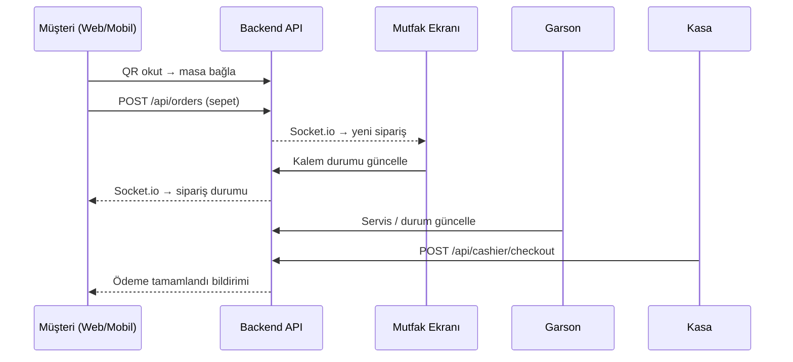
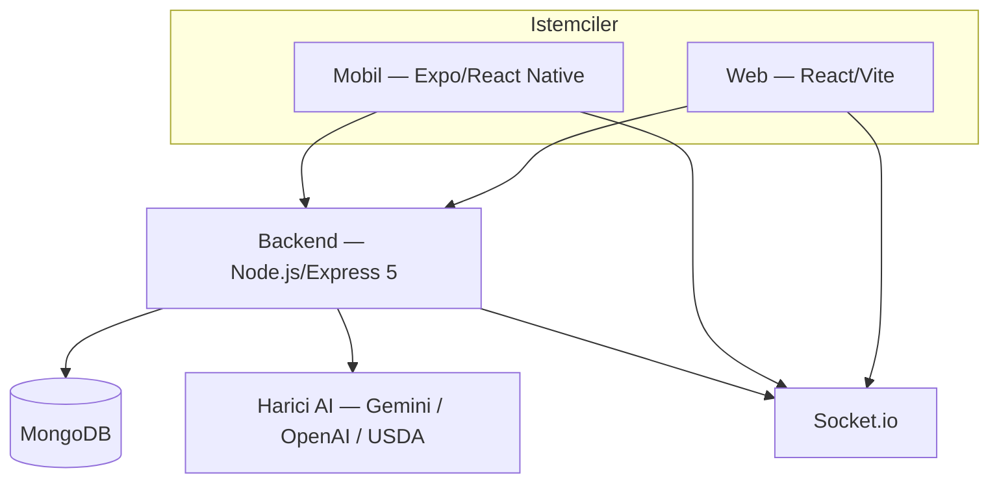

# Self Kasa — Teknik Proje Özeti (Bitirme Tezi Taslağı)

Bu belge, **bitirme-pos-sistemi** (ticari ad: **Self Kasa**) projesinin tez raporuna dönüştürülmesi için hazırlanmış teknik bir özetidir.

---

## 1. Projenin Genel Amacı

**Self Kasa**, restoran ve kafe işletmelerinde geleneksel kasa/sipariş süreçlerini dijitalleştirmek amacıyla geliştirilmiş **üç katmanlı (web + mobil + API)** bir **self-servis POS (Point of Sale)** sistemidir.

### 1.1 Çözülen Problem

Restoranlarda müşteri siparişi, mutfak hazırlığı, garson servisi ve kasa tahsilatı genellikle dağınık kanallarda yürür; iletişim gecikmeleri ve operasyonel hatalar oluşabilir. Bu proje, tüm akışı tek platformda birleştirir.

### 1.2 Temel Hedefler

| Hedef | Açıklama |
|--------|----------|
| Self-servis sipariş | Müşterinin QR kod ile masaya bağlanıp menüden sipariş vermesi |
| Çok rollü operasyon | Garson, mutfak, kasa ve yönetici ekranlarının ayrılması |
| Çok şubeli yönetim | Süper admin ile birden fazla şubenin merkezi kontrolü |
| Gerçek zamanlı takip | Socket.io ile anlık sipariş ve masa durumu güncellemeleri |
| Müşteri deneyimi | Mobil uygulama, sadakat puanı, kampanyalar, sipariş geçmişi |
| Beslenme asistanı | Menü besin değerlerine dayalı yapay zeka kalori sohbeti |
| Güvenlik | JWT kimlik doğrulama, rol bazlı yetkilendirme, rate limiting |

### 1.3 Tipik İş Akışı (Demo Senaryosu)



---

## 2. Sistem Mimarisi

Proje **istemci–sunucu** mimarisinde tasarlanmıştır:



| Katman | Klasör | Kullanıcı profili |
|--------|--------|-------------------|
| Backend | `backend/` | Tüm istemciler (REST + WebSocket) |
| Web | `frontend/` | Müşteri kiosk, admin, garson, mutfak, kasa, süper admin |
| Mobil | `mobile/` | Müşteri (`musteri` rolü) |

---

## 3. Kullanılan Teknolojiler

### 3.1 Backend

| Teknoloji | Sürüm / Not | Kullanım |
|-----------|-------------|----------|
| Node.js | ≥ 18 | Sunucu çalışma ortamı |
| Express | 5.1 | REST API çatısı |
| MongoDB + Mongoose | 8.x | NoSQL veritabanı ve ODM |
| Socket.io | 4.8 | Gerçek zamanlı bildirimler |
| jsonwebtoken | 9.x | JWT oturum yönetimi |
| bcryptjs | 3.x | Şifre hashleme |
| express-rate-limit | 8.x | İstek sınırlama |
| helmet | 8.x | HTTP güvenlik başlıkları (production) |
| multer | 2.x | Profil avatarı yükleme |
| qrcode | 1.5 | QR kod üretimi |
| vitest + supertest | — | Birim/entegrasyon testleri |

### 3.2 Web (Frontend)

| Teknoloji | Kullanım |
|-----------|----------|
| React 19 | UI bileşenleri |
| Vite 7 | Derleme ve geliştirme sunucusu |
| MUI 7 | Material Design bileşenleri |
| React Router 7 | Sayfa yönlendirme |
| TanStack Query | Sunucu durumu ve önbellekleme |
| Axios | HTTP istemcisi |
| Socket.io Client | Gerçek zamanlı güncellemeler |
| html5-qrcode | Web QR tarayıcı |
| Tailwind CSS 4 | Ek stil katmanı |
| ExcelJS / jsPDF | Rapor dışa aktarma |

### 3.3 Mobil

| Teknoloji | Kullanım |
|-----------|----------|
| Expo 54 | Cross-platform mobil geliştirme |
| React Native 0.81 | Native UI |
| React Navigation 7 | Ekran geçişleri |
| expo-camera | QR kod tarama |
| expo-secure-store | Güvenli token saklama |
| AsyncStorage | Oturum ve tercih verileri |
| Jest | Birim testleri |

### 3.4 DevOps

- **Docker Compose**: MongoDB + backend + frontend konteynerleri (`docker-compose.yml`)
- Ortam değişkenleri: `.env` dosyaları (her katmanda ayrı)

---

## 4. Proje Klasör Yapısı

```
bitirme-pos-sistemi/
├── backend/                    # API sunucusu + Socket.io
│   ├── server.js               # Giriş noktası (DB bağlantısı, port dinleme)
│   ├── app.js                  # Express uygulaması fabrikası
│   ├── models/                 # Mongoose şemaları (14 model)
│   ├── routes/                 # REST endpoint grupları
│   ├── middleware/             # Auth, rol, rate limit, upload
│   ├── services/               # AI beslenme servisleri
│   ├── utils/                  # Ödeme, iptal, fiyat, socket yardımcıları
│   ├── scripts/                # Bakım ve bootstrap scriptleri (32 adet)
│   ├── tests/                  # Vitest test dosyaları
│   ├── uploads/avatars/        # Kullanıcı profil görselleri
│   └── Dockerfile
├── frontend/                   # Web uygulaması
│   └── src/
│       ├── app/                # App.jsx, main.jsx (giriş)
│       ├── features/           # Rol bazlı özellik modülleri
│       │   ├── admin/
│       │   ├── auth/
│       │   ├── cashier/
│       │   ├── customer/
│       │   ├── kitchen/
│       │   ├── superadmin/
│       │   └── waiter/
│       └── shared/             # Context, guard, API client, UI
├── mobile/                     # Expo müşteri uygulaması
│   └── src/
│       ├── screens/            # Ekran bileşenleri
│       ├── navigation/         # RootNavigator
│       ├── context/            # Auth, Cart, TableSession, Favorites
│       ├── api/                # HTTP istemci modülleri
│       ├── utils/              # QR parse, fiyat, oturum
│       └── __tests__/          # Jest testleri
├── docs/
│   ├── ARCHITECTURE.md         # Mimari dokümantasyon
│   ├── DEPLOY.md               # Dağıtım kılavuzu
│   └── TEZ_TEKNIK_RAPOR.md     # Bu dosya
├── backups/                    # Yerel JSON veri yedekleri (gitignore)
├── docker-compose.yml
└── README.md
```

---

## 5. Kullanıcı Rolleri ve Yetkilendirme

| Rol | Kod | Erişim |
|-----|-----|--------|
| Süper Admin | `superadmin` | Tüm şubeler, kullanıcı/şube CRUD |
| Admin | `admin` | Tek şube: menü, masa, sipariş, QR, kampanya |
| Yetkili | `yetkili` | Genişletilmiş personel yetkisi |
| Garson | `garson` | Masa yönetimi, sipariş oluşturma, tahsilat |
| Mutfak | `mutfak` | Mutfak kuyruğu, kalem durumu |
| Kasa | `kasa` | Ödeme alma, gün özeti |
| Müşteri | `musteri` | Self-servis sipariş (mobil + web) |

Yetkilendirme zinciri: `authMiddleware` → `requireRole(...)` → `branchAccess` / `requireStaffBranch`

---

## 6. Veri Modelleri (MongoDB Şemaları)

Tüm modeller `backend/models/` altındadır.

| Model | Dosya | Görevi |
|-------|-------|--------|
| **User** | `User.js` | E-posta, şifre hash, rol, şube, sadakat puanı, avatar |
| **Branch** | `Branch.js` | Şube adı, adres, iletişim, aktiflik |
| **Table** | `Table.js` | Masa adı, kapasite, durum (`bos`/`dolu`/`rezerve`/`odeme_bekliyor`) |
| **Category** | `Category.js` | Menü kategorileri (şube bazlı) |
| **Product** | `Product.js` | Ürün adı, fiyat, indirim, görsel, besin değerleri (`nutrition` alt şeması), mutfak istasyonu |
| **MenuItem** | `MenuItem.js` | Eski menü modeli (geriye dönük uyumluluk) |
| **Order** | `Order.js` | Sipariş kalemleri (`orderItems`), durum, ödeme, müşteri, şube |
| **OrderEvent** | `OrderEvent.js` | Sipariş audit kaydı (durum değişiklikleri) |
| **Payment** | `Payment.js` | Tahsilat kaydı (nakit/kart/online) |
| **DailyAggregate** | `DailyAggregate.js` | Günlük ciro özeti (kasa raporu) |
| **Campaign** | `Campaign.js` | Sepet indirim kampanyaları |
| **QRCode** | `QRCode.js` | Masa QR kodları ve payload |
| **StockMovement** | `StockMovement.js` | Stok hareketleri (iptal iadesi vb.) |
| **MealCalorieEstimate** | `MealCalorieEstimate.js` | AI kalori tahmin geçmişi |

**Order** modeli, sipariş yaşam döngüsünü şu alanlarla yönetir:

- `status`: `hazirlaniyor` → `serviste` → `tamamlandi` / `ödendi` / `iptal`
- `orderItems[].status`: `QUEUED` → `STARTED` → `READY` → `SERVED`
- `orderItems[].station`: `hot`, `cold`, `bar`, `dessert` (mutfak istasyonları)
- `paymentStatus`: `unpaid` / `paid` / `refunded`

---

## 7. Backend — Ana Kaynak Dosyaları

### 7.1 Giriş Noktaları

| Dosya | Görevi |
|-------|--------|
| `server.js` | `.env` yükler, MongoDB bağlantısı kurar, HTTP sunucusunu başlatır |
| `app.js` | `createApp()` — Express middleware zinciri, route montajı, Socket.io sunucusu, hata yakalayıcı |

`app.js` içinde kayıtlı API prefix'leri:

```
/api/auth          → authRoutes
/api/superadmin    → superAdminRoutes
/api/waiter        → waiterRoutes
/api/kitchen       → kitchenRoutes
/api/cashier       → cashier
/api/admin         → adminRoutes
/api/qr            → qrRoutes
/api/calorie       → calorieRoutes
/api/campaigns     → campaignRoutes
/api/categories    → categoryRoutes (public GET)
/api/products      → productRoutes (public GET)
/api/orders        → orderRoutes
```

### 7.2 Route Modülleri (İş Mantığı Katmanı)

| Dosya | Temel Endpoint'ler | Açıklama |
|-------|-------------------|----------|
| `authRoutes.js` | `POST /login`, `POST /register`, `GET /me` | Giriş, müşteri kaydı, profil, avatar |
| `orderRoutes.js` | `POST /`, `GET /:id`, `GET /mine` | Müşteri sipariş oluşturma ve takip |
| `adminRoutes.js` | `/stats`, `/products`, `/tables`, `/orders`, `/qr`, `/campaigns` | Şube yönetim paneli API'si |
| `waiterRoutes.js` | `/tables`, `/orders`, `/payments` | Garson operasyonları |
| `kitchenRoutes.js` | `/queue`, `/items/:id/start`, `/items/:id/ready` | Mutfak kuyruğu ve kalem durumu |
| `cashier.js` | `/tables`, `/summary`, `/checkout/:tableId` | Kasa tahsilat ve gün özeti |
| `superAdminRoutes.js` | `/branches`, `/users` | Çok şubeli merkezi yönetim |
| `qrRoutes.js` | `/generate/:tableNumber`, CRUD | QR kod üretimi ve yönetimi |
| `calorieRoutes.js` | `POST /chat`, `POST /estimate` | AI kalori sohbeti ve tahmin |
| `productRoutes.js` | `GET /` | Herkese açık menü listesi |
| `categoryRoutes.js` | `GET /` | Herkese açık kategori listesi |
| `campaignRoutes.js` | `GET /` | Aktif kampanyalar |

### 7.3 Servis Katmanı (AI / Beslenme)

| Dosya | Görevi |
|-------|--------|
| `nutritionChatService.js` | Menü tabanlı AI kalori asistanı: şube menüsünü yükler, Gemini ile sohbet yanıtı üretir, ürün eşleştirme (Türkçe token analizi), sepet kalori hesabı |
| `geminiNutritionService.js` | Google Gemini API ile ürün besin değeri tahmini |
| `aiNutritionService.js` | OpenAI/Gemini sağlayıcı yönlendirmesi; admin panelinden ürün besin değeri üretimi |
| `nutritionEstimateShared.js` | Ortak prompt, JSON parse, sanitizasyon yardımcıları |

**Kalori sohbet akışı** (`nutritionChatService.js`):

1. `loadBranchMenu(branchId)` — onaylı besin değerli ürünleri MongoDB'den çeker (5 dk önbellek)
2. `rankProductsForMessage()` — kullanıcı mesajından ürün eşleştirme
3. `buildChatSystemPrompt()` — Gemini'ye şube menüsü JSON'u ile sistem promptu
4. `handleNutritionChat()` — ana giriş fonksiyonu; `POST /api/calorie/chat` tarafından çağrılır

**Kalori tahmin** (`calorieRoutes.js`):

- `MEAL_ITEM_DB` — gömülü Türk mutfağı kalori sözlüğü (~30 kalem)
- OpenAI (metin + görsel) veya USDA FoodData Central API yedek
- Sonuç `MealCalorieEstimate` koleksiyonuna kaydedilir

### 7.4 Yardımcı Modüller (Utils)

| Dosya | Görevi |
|-------|--------|
| `recordOrderPayment.js` | Merkezi tahsilat: Payment + OrderEvent + DailyAggregate + socket bildirimi |
| `orderPayment.js` | Ödeme durumu yardımcıları (`isOrderPaid`, `applyPaidToOrder`) |
| `orderCancel.js` | Erken iptal mantığı ve stok iadesi |
| `orderQueries.js` | Açık sipariş / ödenmemiş sorgu filtreleri |
| `pricing.js` | Kampanya indirimi, efektif fiyat hesabı |
| `loyaltyPoints.js` | Sadakat puanı kazanma ve kullanma |
| `customerOrderNotify.js` | Müşteriye Socket.io ile sipariş güncellemesi |
| `socketRooms.js` | Şube bazlı socket oda isimlendirme |
| `authValidation.js` | E-posta ve güçlü şifre politikası |
| `avatarStorage.js` | Profil görseli dosya yönetimi |
| `envSecurity.js` | JWT secret güvenlik uyarısı |

### 7.5 Middleware

| Dosya | Görevi |
|-------|--------|
| `authMiddleware.js` | JWT doğrulama; `req.user` doldurma |
| `requireRole.js` | Rol bazlı erişim kontrolü |
| `branchAccess.js` | Şube kapsamı doğrulama |
| `requireStaffBranch.js` | Personelin kendi şubesine erişimi |
| `requireSuperAdmin.js` | Süper admin koruması |
| `socketAuth.js` | WebSocket bağlantısında JWT; oda abonelikleri (`kitchen.*`, `waiter.*`, `customer.*`) |
| `rateLimiters.js` | Giriş ve kalori endpoint'leri için özel limitler |
| `uploadAvatar.js` | Multer ile avatar yükleme |

---

## 8. Gerçek Zamanlı İletişim (Socket.io)

`socketAuth.js` üzerinden JWT doğrulamalı bağlantılar kurulur. Oda yapısı:

| Oda | Abone roller | Olay örnekleri |
|-----|--------------|----------------|
| `kitchen.{branchId}.{station}` | mutfak, admin | Yeni sipariş kalemi |
| `waiter.{waiterId}` | garson | Hazır sipariş bildirimi |
| `admin.metrics.{branchId}` | admin | Dashboard metrikleri |
| `tables.{branchId}` | admin, garson, mutfak, kasa | Masa durumu |
| `customer.{userId}` | müşteri | `order:status:updated` |

---

## 9. Web Frontend — Ana Dosyalar

Giriş: `frontend/src/app/main.jsx` → `App.jsx`

### 9.1 Rota Yapısı (`App.jsx`)

| Yol | Rol | Sayfa |
|-----|-----|-------|
| `/`, `/menu`, `/sepet`, `/qr-scan` | Herkese açık | Müşteri kiosk |
| `/login` | — | Giriş |
| `/waiter/*` | garson, admin, yetkili | Garson paneli |
| `/kitchen/*` | mutfak, admin, yetkili | Mutfak ekranı |
| `/cashier/*` | kasa, admin, yetkili | Kasa paneli |
| `/admin/*` | admin | Yönetim paneli |
| `/superadmin/*` | superadmin | Merkezi yönetim |

### 9.2 Önemli Bileşenler

| Dosya | Görevi |
|-------|--------|
| `shared/context/AuthContext.jsx` | JWT oturum yönetimi |
| `shared/context/CartContext.jsx` | Sepet durumu (web müşteri) |
| `shared/guards/RoleGuard.jsx` | Rol bazlı rota koruması |
| `shared/utils/socketClient.js` | Socket.io istemci bağlantısı |
| `features/customer/hooks/useOrderTracking.js` | Sipariş durumu takibi |
| `features/kitchen/pages/KitchenDisplayPage.jsx` | Mutfak kuyruk ekranı |
| `features/cashier/pages/CashierDashboard.jsx` | Kasa masa listesi ve tahsilat |
| `features/admin/pages/AdminDashboard.jsx` | KPI dashboard |
| `features/admin/pages/ProductManagementPage.jsx` | Ürün CRUD + besin değeri |
| `features/admin/pages/QRCodeManagementPage.jsx` | QR kod yönetimi |

---

## 10. Mobil Uygulama — Ana Dosyalar

Giriş: `mobile/src/App.jsx` → `navigation/RootNavigator.jsx`

### 10.1 Ekranlar

| Ekran | Dosya | Görevi |
|-------|-------|--------|
| Giriş / Kayıt | `LoginScreen`, `RegisterScreen` | Müşteri kimlik doğrulama |
| Ana Sayfa | `HomeScreen` | QR tarama kartı, kampanya, profil |
| QR Tarama | `QRScannerScreen` | Masa bağlama |
| Menü | `MenuScreen` | Ürün listesi ve sepete ekleme |
| Sepet | `CartScreen` | Sipariş tamamlama, ödeme yöntemi |
| Kalori Asistanı | `CalorieEstimateScreen` | AI sohbet arayüzü |
| Sipariş Geçmişi | `OrderHistoryScreen` | Geçmiş siparişler |
| Sadakat | `LoyaltyPointsScreen` | Parapuan görüntüleme |
| Kampanyalar | `CampaignsScreen` | Aktif kampanyalar |
| Profil | `ProfileScreen` | Hesap ayarları |

### 10.2 Context ve API

| Dosya | Görevi |
|-------|--------|
| `context/AuthContext.jsx` | Token ve kullanıcı oturumu |
| `context/CartContext.jsx` | Sepet + besin değeri toplama |
| `context/TableSessionContext.jsx` | QR ile bağlanan masa oturumu |
| `context/FavoritesContext.jsx` | Favori ürünler |
| `api/client.js` | Axios tabanlı API istemcisi |
| `api/calorie.js` | `sendNutritionChat()` — kalori asistanı API çağrısı |
| `utils/parseQrPayload.js` | QR payload ayrıştırma |
| `utils/tableSessionCore.js` | Masa oturum mantığı |

---

## 11. Bakım ve Bootstrap Scriptleri

`backend/scripts/` altında 32 script bulunur. Tezde öne çıkarılabilecekler:

| Script | Amaç |
|--------|------|
| `createSuperAdmin.js` | İlk süper admin kullanıcısı oluşturma |
| `createGarsonUser.js` | Garson test kullanıcısı |
| `createKasaUser.js` | Kasa test kullanıcısı |
| `migrateToBranches.js` | Tek şubeden çok şubeli yapıya geçiş |
| `migrateOrderStatus.js` | Sipariş durum alanı migrasyonu |
| `migratePasswordToPasswordHash.js` | Şifre hash formatı güncelleme |
| `publishBranchNutritionBatch.js` | Toplu besin değeri yayınlama |
| `publishBranchNutritionToCustomers.js` | Müşteriye görünür besin değerleri |
| `backfillKitchenStatus.js` | Mutfak kalem durumu doldurma |
| `restoreOrdersFromBackup.js` | Yedekten sipariş geri yükleme |
| `setUserRole.js` / `updateUserRoles.js` | Rol düzenleme |
| `fixQRCodeIndexes.js` | Veritabanı indeks onarımı |

---

## 12. Test Altyapısı

### Backend (`backend/tests/` — Vitest)

| Test dosyası | Kapsam |
|--------------|--------|
| `api.test.js` | Genel API entegrasyon testleri |
| `orderPayment.test.js` | Sipariş ödeme akışı |
| `recordOrderPayment.test.js` | Tahsilat kayıt fonksiyonu |
| `loyaltyPoints.test.js` | Sadakat puanı hesabı |
| `setup.js` | MongoDB Memory Server test ortamı |

### Mobil (`mobile/__tests__/` — Jest)

| Test dosyası | Kapsam |
|--------------|--------|
| `parseQrPayload.test.js` | QR payload ayrıştırma |
| `tableSessionCore.test.js` | Masa oturum mantığı |
| `productPricing.test.js` | Fiyat hesaplama |
| `loyaltyPoints.test.js` | Puan hesabı |
| `authValidation.test.js` | Şifre politikası |
| `authSession.test.js` | Oturum yönetimi |

---

## 13. Veri Setleri

Projede harici bir ML eğitim veri seti **bulunmamaktadır**. Veri kaynakları:

| Kaynak | Konum | Açıklama |
|--------|-------|----------|
| **MEAL_ITEM_DB** | `calorieRoutes.js` içinde gömülü | ~30 Türk/uluslararası yemek kalemi ve tipik kalori değerleri |
| **MongoDB koleksiyonları** | Canlı veritabanı | Ürün, sipariş, kullanıcı verileri (işletme verisi) |
| **USDA FoodData Central** | Harici API | Açık kaynak besin veritabanı (yedek tahmin) |
| **Gemini / OpenAI** | Harici API | Ürün besin değeri ve sohbet yanıtı üretimi |
| **backups/** | Proje kökü | Yerel JSON yedekleri (gitignore; repoda yok) |

---

## 14. Güvenlik Önlemleri

- **JWT** tabanlı kimlik doğrulama (`Authorization: Bearer`)
- **bcrypt** ile şifre hashleme (pre-save hook)
- **Güçlü şifre politikası**: 8+ karakter, büyük/küçük harf, rakam, sembol
- **Rate limiting**: Genel API (100/15dk production), giriş ve kalori endpoint'leri özel limit
- **Helmet** HTTP başlıkları (production)
- **CORS** whitelist + yerel ağ desteği (development)
- **Rol middleware** ile endpoint koruması
- **Şube izolasyonu**: Personel yalnızca kendi şubesine erişir
- **ALLOW_PUBLIC_REGISTER**: Production'da müşteri kaydı kapatılabilir
- **Socket.io JWT**: WebSocket bağlantıları da doğrulanır

---

## 15. Bilinçli Kapsam Dışı Bırakılanlar

Tezde "sınırlamalar" bölümünde belirtilebilir:

- Fiş yazıcı entegrasyonu
- E-fatura / mali mühür
- Gerçek ödeme gateway (iyzico, Stripe vb.) — mobilde `online` ödeme mock
- Vardiya kasası / kasa devri
- Bölünmüş hesap (split bill) UI
- İade (refund) kullanıcı arayüzü

---

## 16. Tez Bölüm Eşlemesi (Öneri)

| Tez Bölümü | Projedeki Karşılık |
|------------|-------------------|
| Giriş / Problem Tanımı | Bölüm 1 |
| Literatür / İlgili Çalışmalar | QR self-order, POS, restoran otomasyonu |
| Sistem Analizi ve Tasarım | Bölüm 2, 5, 6, 8 |
| Kullanılan Teknolojiler | Bölüm 3 |
| Uygulama / Gerçekleştirme | Bölüm 7–10 |
| Test ve Değerlendirme | Bölüm 12 + demo senaryosu |
| Sonuç ve Gelecek Çalışmalar | Bölüm 15 |

---

## 17. Önerilen Tez Başlığı

**QR Kod Tabanlı Self-Servis Restoran Sipariş ve Operasyon Yönetim Sistemi: Web, Mobil ve Gerçek Zamanlı Çok Rollü Mimari ile Tasarım ve Uygulama**

---

*Son güncelleme: Haziran 2025 — Self Kasa (bitirme-pos-sistemi)*
